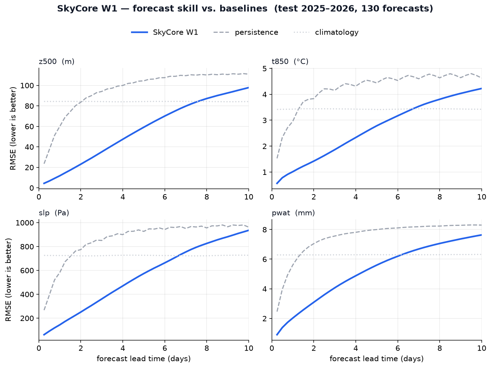

<div align="center">

# 🌦️ SkyCore W1 — the We Models base

### A 0.7M-parameter global weather model you can train from scratch, and fork

W1 is the open community base of the SkyCore project: a tiny [GraphCast](https://www.science.org/doi/10.1126/science.adi2336)-style network, **small enough to train on one GPU in a few hours**, with both code and weights available under the **KeeAI SkyCore License** (free for research & non-commercial use).

[](LICENSE) [](https://skycore.keeai.cloud/buy)


[](https://github.com/SkyCore-lab/SkyCore-WeModelsProject/stargazers)

**The official distribution (all SkyCore models) lives at [SkyCore ›](https://github.com/SkyCore-lab/SkyCore).**

</div>

---

## ✨ Why start from W1

- 🪶 **Tiny & readable.** ~690k parameters, one file (`skycore.py`) for data prep, model, training, scoring, and forecasting.
- ⚡ **One GPU, a few hours.** Mixed precision + gradient checkpointing + an auto batch-size finder that recovers from out-of-memory on its own.
- 🌐 **Real forecasts.** Global 2.5° grid (73×144), 6-hour steps, 17 variables, autoregressive out to 10 days.
- 📈 **Genuinely skillful** (chart below) — beats persistence and climatology on every variable and lead.
- 🔓 **Source-available.** KeeAI SkyCore License: free for research & non-commercial use, paid for commercial.
- 🧩 **A clean base to fork.** Add variables, go to a finer grid, swap the backbone.

## 📊 Forecast skill

RMSE vs. forecast lead time — **lower is better.** W1 (blue) stays well under *persistence* and *climatology* out to 10 days.



<sub>Test 2025–2026, 130 forecasts. RMSE: z500 — 11.7 / 35.1 / 59.1 m at 1 / 3 / 5 days (persistence at 1 day: 59.9 m). ACC ≥ 0.6 holds to ~6 days for z500 and ~5.5 days for temperature and sea-level pressure.</sub>

> **Note on comparability.** These numbers are measured on W1's own test data on a coarse 2.5° grid. They are **not directly comparable** to GraphCast or operational high-resolution models, which use finer grids and different ground truth. Read them as confirmation that W1 is a working weather model, not as a leaderboard ranking.

## 🧠 How it works

- **Input**: the last two states (now and 6 h ago) + time cues (season, local solar time, lat/lon) + terrain and land/sea mask.
- **Output**: the 6-hour *tendency*, added to the current state (learning the change is easier than the field).
- **Backbone**: ConvNeXt-style conv net (7×7 depthwise → GroupNorm → 1×1 ×4 expand → GELU → project, ×8). Longitude is **circular-padded**, the poles **replicate-padded**.
- **Loss**: latitude-area-weighted MSE, normalized by the spread of the 6-hour change.
- **Two phases**: one step ahead, then a **4-step rollout** at 1/10 the learning rate so compounding errors are penalized.

## 🚀 Quickstart

```bash
git clone https://github.com/SkyCore-lab/SkyCore-WeModelsProject.git
cd SkyCore-WeModelsProject

# prepare -> train -> score, all at once
python skycore.py all --model w1 --data ./data --out ./out

# or forecast with the released weights (already in w1/)
python skycore.py forecast --model w1 --data ./data --out ./w1
```

Missing libraries (numpy / torch / eccodes, …) install on first run. The first data download takes a while, then it's cached.

## 📦 Files

| File | Role |
|---|---|
| `skycore.py` | Everything: data prep, model, training, scoring, forecasting |
| `skycore_jax.py` | JAX backend (TPU; verified equal to PyTorch — weights are interchangeable) |
| `test_backends.py` | Test that the two backends agree |
| `w1/model.pt`, `w1/scores.json` | Trained W1 weights + the full score tables |

## 📜 The "We" line rules

- The base is **W-series only** (never S/D).
- Training data must be **openly licensed (CC0) only**.
- Keep it small and readable — this is a base people fork.

## 🌱 Contribute

Fork it, train a variant, open a PR with your scores. Issues and experiments welcome.

**If W1 helps you, a ⭐ makes it easier for others to find.**

## 📄 License

W1 is distributed under the **KeeAI SkyCore License** (see [LICENSE](LICENSE)).

- **Free** for research and personal non-commercial use — display **"By KeeAISkyCore"** when you publish.
- **Commercial use** requires a paid plan: **[skycore.keeai.cloud/buy](https://skycore.keeai.cloud/buy)**.
